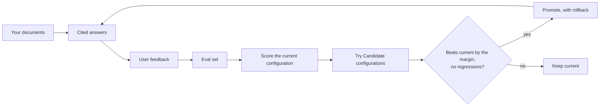
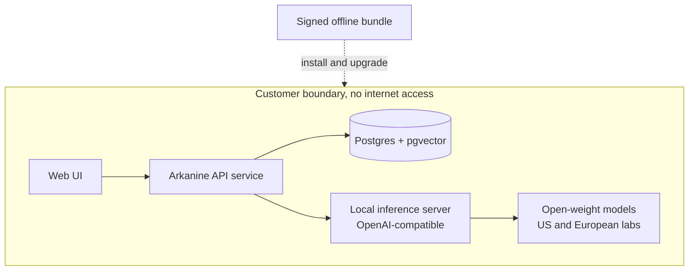

  

<h3 align="center">Air-Gapped private AI that you own, runs inside your walls and only changes when your own tests say it got better.</h3>

  
  
  

  <a href="#the-problem">Problem</a> ·
  <a href="#what-arkanine-does">What it does</a> ·
  <a href="#how-it-gets-better">How it gets better</a> ·
  <a href="#security">Security</a> ·
  <a href="#roadmap">Roadmap</a> ·
  <a href="#faq">FAQ</a>

---

Arkanine is an AI system you run on your own infrastructure. It answers questions about your documents with citations, works with no internet connection, and only changes when your own tests show it got better.

> [!NOTE]
> **Pre-alpha.** The MVP is being built in the open and nothing here is production-ready yet. See the [roadmap](#roadmap).

## The problem

Some of the most useful documents in the economy can't go into a chat window: engineering specifications at a defence supplier, matter files at a law firm, policy and case records at a bank. Contracts, export controls and regulators keep them inside the building, so the people who work with them get none of the benefit of modern language models.

The alternatives each give something up. Doing without means searching shared drives by hand and losing knowledge when people leave. A vendor-run private platform means someone else controls the system and every change to it. An open-source "chat with your documents" tool is a good start, but nobody can say how accurate it is, or whether last month's model upgrade made it better or worse.

## What Arkanine does

Staff ask questions in plain language and get an answer with citations to the passages it came from. If the documents don't contain the answer, it says so. Access is set per Collection of documents, so people only get answers from material they're allowed to see.

All of it runs on hardware you control. Arkanine installs from a signed offline bundle, makes no outbound connections and sends no telemetry, so it runs on a disconnected network. You decide where it lives, what goes into it and when it changes. We license the software and never hold your data.

|                                 | Where your data goes | How it improves                             | Offline                              |
| ------------------------------- | -------------------- | ------------------------------------------- | ------------------------------------ |
| Public LLM API                  | Leaves your boundary | When the vendor updates the model           | No                                   |
| Vendor-hosted private platform  | Vendor-controlled    | On the vendor's schedule                    | Sometimes                            |
| Open-source chat with documents | Stays with you       | Not measured                                | Often, with effort                   |
| **Arkanine**                    | Stays with you       | Scored on your own questions, with rollback | Yes, tested with networking disabled |

## How it gets better

Most private AI setups are tuned once by whoever installed them. Arkanine treats quality as something to measure.

It starts with an **Eval set**: a list of questions from your own organisation, each with the expected answer and the passage it should come from. The local model drafts candidate questions from your documents, a reviewer approves or edits them, and thumbs-up or thumbs-down feedback from users adds more over time.

Each improvement cycle then tries **Candidate configurations**, which are different choices for chunking, embedding model, reranking and prompts, and scores every one against the Eval set. A candidate is promoted only if it beats the current configuration by a margin you set and breaks nothing that passed before.

Here is an illustrative cycle. A smaller chunk size lifts the score on a 120-question Eval set from 71% to 78%, but two questions that used to pass now fail, so the change is refused. A second candidate reaches 76% with no regressions and is promoted. If a problem shows up later, one action rolls it back.

Upgrades follow the same rule. When a new release or base model arrives as a signed bundle, the Eval set is re-scored before anything changes, so an upgrade can't quietly make answers worse, and the improvements you've earned carry over.

## Architecture

A single-node deployment, entirely inside your boundary. Postgres with pgvector is the only datastore, holding both relational data and embeddings. Models are served through an OpenAI-compatible endpoint, so the same code runs on Ollama or llama.cpp on a Mac and on vLLM on a GPU server. Software enters the boundary only as a signed offline bundle of images, model weights, the embedding model, assets and checksums.

## Security

| Concern                   | Approach                                                                                                                                                               |
| ------------------------- | ---------------------------------------------------------------------------------------------------------------------------------------------------------------------- |
| Data leaving the boundary | No telemetry, licence checks, crash reports or runtime downloads ([ADR 0003](docs/adr/0003-zero-phone-home.md)). Tested by running the suite with networking disabled. |
| Tampered software         | Signed bundles, with the public key shipped in the install and verified offline.                                                                                       |
| Malicious documents       | Document text is content, never instructions. The model has no tools, web access or code execution.                                                                    |
| Unauthorised access       | Retrieval filters by the asking user's Collections before ranking, so inaccessible content never reaches the model or citations.                                       |
| Model supply chain        | Only open-weight models from US and European labs, with a published provenance list ([ADR 0002](docs/adr/0002-model-provenance.md)).                                   |

"Air-gapped" here means verified with networking disabled, not accredited for classified networks. Not in the MVP: SSO, permission inheritance from source systems, data deletion and formal accreditation.

## Roadmap

The MVP is done when this runs end to end with networking disabled: install from the bundle, ingest a public UK government corpus, ask cited questions, build an Eval set, collect feedback, run an improvement cycle, and show the before and after score with promote or rollback.

The spec is [#1](https://github.com/JoravarSinghPunia/arkanine-ai/issues/1), and each ticket declares what blocks it.

**Stage one: installable, air-gap-verified cited Q&A**

|                                                           Issue | Ticket                                   |
| --------------------------------------------------------------: | ---------------------------------------- |
| [#2](https://github.com/JoravarSinghPunia/arkanine-ai/issues/2) | Walking skeleton and test harness        |
| [#3](https://github.com/JoravarSinghPunia/arkanine-ai/issues/3) | Ingest text and answer a cited question  |
| [#4](https://github.com/JoravarSinghPunia/arkanine-ai/issues/4) | Local accounts and per-Collection access |
| [#5](https://github.com/JoravarSinghPunia/arkanine-ai/issues/5) | PDF, DOCX and HTML ingestion             |
| [#6](https://github.com/JoravarSinghPunia/arkanine-ai/issues/6) | Inference backends and model provenance  |
| [#7](https://github.com/JoravarSinghPunia/arkanine-ai/issues/7) | Signed offline bundle                    |
| [#8](https://github.com/JoravarSinghPunia/arkanine-ai/issues/8) | Air-gap test                             |

**Stage two: the improvement loop and demo**

|                                                             Issue | Ticket                                         |
| ----------------------------------------------------------------: | ---------------------------------------------- |
|   [#9](https://github.com/JoravarSinghPunia/arkanine-ai/issues/9) | Eval set builder                               |
| [#10](https://github.com/JoravarSinghPunia/arkanine-ai/issues/10) | Feedback into the Eval set                     |
| [#11](https://github.com/JoravarSinghPunia/arkanine-ai/issues/11) | Deterministic scoring                          |
| [#12](https://github.com/JoravarSinghPunia/arkanine-ai/issues/12) | Local-model judge                              |
| [#13](https://github.com/JoravarSinghPunia/arkanine-ai/issues/13) | Candidate configurations and improvement cycle |
| [#14](https://github.com/JoravarSinghPunia/arkanine-ai/issues/14) | Promotion and rollback                         |
| [#15](https://github.com/JoravarSinghPunia/arkanine-ai/issues/15) | Upgrade re-scoring                             |
| [#16](https://github.com/JoravarSinghPunia/arkanine-ai/issues/16) | Local dashboard                                |
| [#17](https://github.com/JoravarSinghPunia/arkanine-ai/issues/17) | Minimal web UI                                 |
| [#18](https://github.com/JoravarSinghPunia/arkanine-ai/issues/18) | Demo corpus and scripted scenario              |

Out of scope for the MVP: workflows and agents, OCR, SSO, fine-tuning, data deletion, analytics and formal accreditation.

## Getting started

Needs Python 3.9+ and Docker with Compose. `make bundle` and `make airgap-test` print "not implemented yet" until their tickets land.

| Command            | Purpose                                                                         |
| ------------------ | ------------------------------------------------------------------------------- |
| `make setup`       | Install dependencies into `.venv`                                               |
| `make dev`         | Run the stack locally; the API health check is at `localhost:8000/health`       |
| `make test`        | Run the API suite against a throwaway Compose stack and a fake inference server |
| `make lint`        | Run linters and type checks                                                     |
| `make bundle`      | Build the signed offline bundle                                                 |
| `make airgap-test` | Run the suite with networking disabled                                          |

A laptop or Mac with small quantised models is enough for demos. Pilots on real documents expect a single customer-supplied GPU server. See [GLOSSARY.md](GLOSSARY.md) for the shared vocabulary and [docs/adr/](docs/adr/) for architecture decisions.

## FAQ

<strong>Is this a hosted service?</strong>

No. You run it inside your own infrastructure, and we never hold your data.

<strong>Do you fine-tune models on our documents?</strong>

Not in the MVP. The improvement loop tunes retrieval and prompts. Fine-tuning comes later, once the evaluations exist to show it helps.

<strong>Why only US and European models?</strong>

Security reviewers in sensitive sectors are likely to reject other origins regardless of benchmark scores, so provenance is a stated guarantee. See [ADR 0002](docs/adr/0002-model-provenance.md).

<strong>What is paid?</strong>

Enterprise features such as SSO and audit tooling will be sold under a separate commercial licence. The core runtime and evaluation harness stay Apache-2.0.

## Contributing

Early days. Open an issue or comment on a ticket. Don't put confidential or customer data anywhere in this repository.

## Licence

Apache-2.0. See [LICENSE](LICENSE).
